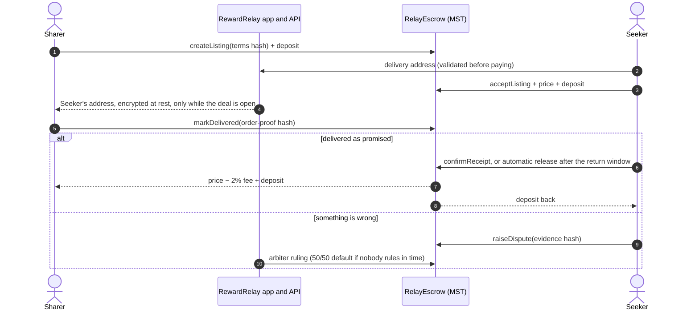
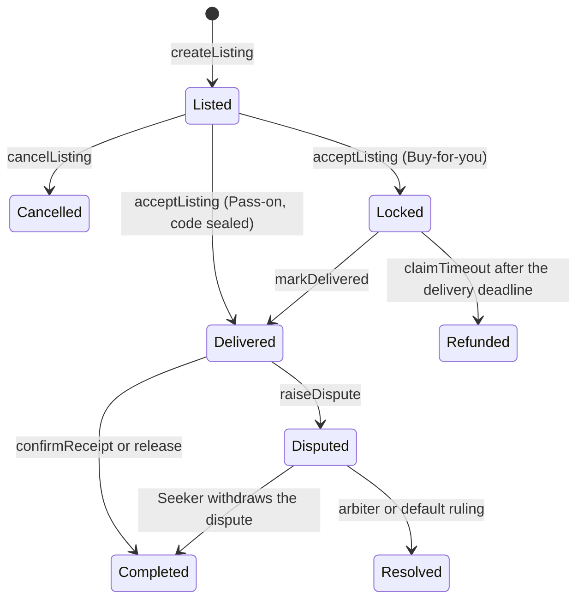
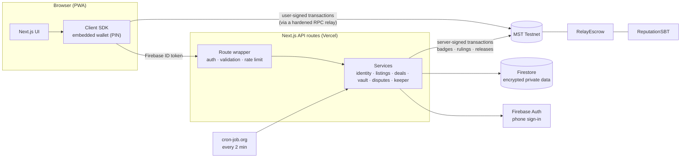

<div align="center">

# RewardRelay

**A trusted buy-it-for-me marketplace for unused rewards, secured by escrow and on-chain reputation on
MST Blockchain.**

[](https://github.com/Atharvchaskar008/RewardRelay/actions/workflows/ci.yml)
[](LICENSE)
[](https://testnet.mstscan.com/address/0x5aB34fB9CFce4a442b2CA773692a7D031D173C9A)
[](packages/contracts)
[](.nvmrc)
[](docs/testing.md)

[How it works](#how-it-works) · [Architecture](#architecture) · [Getting started](#getting-started) ·
[Testing](#testing) · [Deployments](#deployments) · [Security](#security) · [Docs](#documentation)

</div>

---

## Overview

Millions of rewards expire unused: bank-card offers, wallet credits, membership prices, shareable promo
codes. The people who hold them rarely need them, and the people who want them have no safe way to get
them from a stranger.

RewardRelay lets the holder of a benefit (the **Sharer**) use it for someone who wants the discount (the
**Seeker**). The Seeker's payment sits in an escrow smart contract until the benefit is delivered, both
sides lock a deposit that a cheater loses to the other side, and every finished deal builds a
soulbound **Trust Badge** that raises the user's deal limit.

> Built for **MST Blockchain Buildathon #2** (Round 2, MVP sprint). It runs on **MST Testnet** with test
> MSTC; no real money moves.

### Highlights

- **No credentials ever change hands.** The Sharer orders in their own account and delivers to the
  Seeker; codes are sealed and revealed only to the Seeker who paid.
- **Escrow with deposits on both sides.** Price and deposits are held by `RelayEscrow`; deadlines,
  automatic release, refunds and dispute payouts are enforced by the contract.
- **Portable reputation.** `ReputationSBT` (ERC-5192) records completed deals, unique counterparties
  and lost disputes; any MST app can read `trustOf(address)`.
- **Web2 onboarding.** Phone sign-in, a PIN-protected embedded wallet and a gas top-up: users never
  handle a seed phrase.
- **Privacy by design.** Addresses, order proofs and codes are envelope-encrypted off-chain; only their
  hashes go on-chain, and every read re-checks the deal's on-chain state.

## How it works

| Deal type       | How the benefit reaches the Seeker                                                                                  | Categories                                                         |
| --------------- | ------------------------------------------------------------------------------------------------------------------- | ------------------------------------------------------------------ |
| **Buy-for-you** | The Sharer places the order in their own account, with their own offer, delivered to the Seeker's name and address. | Shopping card offers, travel, food, movies and events, memberships |
| **Pass-on**     | The Sharer's shareable code is sealed in the Code Vault when listed and revealed only to the Seeker who paid.       | Shareable codes and vouchers                                       |



<details>
<summary><strong>Deal states</strong></summary>



</details>

### Trust and safety rules

| Rule                   | New                    | Trusted                                     | Verified                                      |
| ---------------------- | ---------------------- | ------------------------------------------- | --------------------------------------------- |
| Reached with           | phone-verified sign-up | 5 completed deals, 3 counterparties, 0 lost | 20 completed deals, 10 counterparties, 0 lost |
| Deal limit (demo rate) | ₹500                   | ₹2,000                                      | ₹10,000                                       |
| Sharer deposit         | 50% of the price       | 30%                                         | 20%                                           |

- The Seeker deposits 5% of the price. The 2% platform fee applies only to the part of the price paid
  out to the Sharer (none on refunds or on the default ruling).
- A Sharer who misses the delivery deadline loses their deposit to the Seeker, and a dispute ruled
  against a party moves that party's deposit to the other side.
- Blocked by design: cashing out wallet balances, employee or student-only discounts, IRCTC and railway
  tickets, sharing accounts, logins, passwords or OTPs, and regulated goods.
- One phone number maps to one wallet, so reputation cannot be farmed with throwaway accounts.

## Why MST Blockchain

Strangers trading benefits need a neutral party that holds money and enforces deadlines. On MST the
escrow, deposits, timers, code fingerprints, proof hashes and reputation are public and verifiable
(about 3-second blocks, fixed 1 gwei gas), while personal data stays off-chain and encrypted. Users
onboard with a phone number, and the Trust Badge is a reusable, on-chain trust signal for the wider MST
ecosystem.

## Architecture



- **The chain is the source of truth:** every privileged action (reveal an address or a code, accept
  a proof, rule on a dispute) re-reads the deal on-chain first.
- **The UI needs no blockchain logic:** the API returns view models with `nextAction`, deadlines, ₹ and
  MSTC amounts and explorer links; the SDK runs the transactions behind each button.

Read more in [docs/architecture.md](docs/architecture.md) and [docs/protocol.md](docs/protocol.md).

## Tech stack

| Layer           | Technology                                                                                         |
| --------------- | -------------------------------------------------------------------------------------------------- |
| Smart contracts | Solidity 0.8.24 (Shanghai), OpenZeppelin Contracts 5.0, Hardhat 2, solidity-coverage, Slither      |
| Web app and API | Next.js 15 (App Router), React 19, TypeScript 5, TanStack Query, zod                               |
| Chain access    | viem 2 (legacy 1 gwei transactions), EIP-712 listing authorisations, EIP-4361-style wallet linking |
| Identity        | Firebase Authentication (phone), PIN-encrypted embedded wallet (PBKDF2 + AES-GCM)                  |
| Data            | Cloud Firestore (asia-south1) with envelope encryption (AES-256-GCM) for private data              |
| Tooling         | npm workspaces, Vitest, Firebase emulators, ESLint, Prettier, GitHub Actions                       |

## Repository layout

```
.
├── apps/
│   └── web/                  Next.js app: UI pages, API routes, server modules, client SDK
│       ├── src/app/          pages and API route handlers
│       ├── src/server/       services: identity, listings, deals, vault, disputes, keeper, signer
│       ├── src/client/       client SDK (API client, transactions, React hooks), embedded wallet
│       ├── src/common/       code shared by browser and server (terms hash, delivery details)
│       ├── test/             unit, integration and end-to-end tests
│       └── firestore.rules   Firestore security rules (+ indexes, firebase.json)
├── packages/
│   ├── contracts/            RelayEscrow, ReputationSBT, tests, deploy/configure/verify scripts
│   │   └── deployments/      on-chain deployment records (addresses, transactions)
│   └── shared/               ABIs, deployment addresses, chain config and protocol rules
├── docs/                     architecture, protocol, API, deployment, testing, demo guide
└── .github/                  CI workflow, issue and pull-request templates, code owners
```

## Getting started

### Prerequisites

- Node.js 22 or newer (see `.nvmrc`) and npm 10+
- Java 21, only for the Firebase emulators used by the integration tests
- A Firebase project (Authentication with phone sign-in, Firestore) to run the app against real services

### Install and run

```bash
git clone https://github.com/Atharvchaskar008/RewardRelay.git
cd RewardRelay
npm install
npm run compile                          # Solidity → ABIs and TypeChain types

cp apps/web/.env.example apps/web/.env   # every variable is documented in the file
npm run dev                              # local Hardhat node + Next.js on http://localhost:3000
```

The server validates its environment at startup and names any missing or malformed variable. To run
against MST Testnet, set `MST_RPC_URL`, `MST_CHAIN_ID` and the contract addresses from
[Deployments](#deployments); for a fully local stack, deploy the contracts to the Hardhat node and
use the Firebase emulators. Both setups, Firebase and Vercel are described in
[docs/deployment.md](docs/deployment.md).

### Useful commands

| Command                      | What it does                                                              |
| ---------------------------- | ------------------------------------------------------------------------- |
| `npm run dev`                | Local Hardhat node and the Next.js dev server                             |
| `npm run lint`               | Solhint, ESLint and the Prettier check                                    |
| `npm test`                   | Contract tests and web unit tests                                         |
| `npm run test:integration`   | API, SDK and end-to-end tests on the Firebase emulators and a local chain |
| `npm run contracts:coverage` | Solidity coverage report                                                  |
| `npm run contracts:gas`      | Gas report for the main contract functions                                |
| `npm run build`              | Type-check and build every workspace                                      |

## Testing

| Layer                      | Tooling                                                           | Result                                                     |
| -------------------------- | ----------------------------------------------------------------- | ---------------------------------------------------------- |
| Smart contracts            | Hardhat, Chai; adversarial and randomized invariant tests         | **100 tests**, **100%** statements, branches, lines        |
| Static analysis            | Slither 0.11, Solhint                                             | 0 high and 0 medium findings                               |
| Web unit                   | Vitest                                                            | **174 tests**                                              |
| Integration and end-to-end | Vitest, Firebase Auth and Firestore emulators, local Hardhat node | **56 tests**, both deal types and disputes through the SDK |
| Live network               | Browser and scripted runs on MST Testnet                          | Buy-for-you, Pass-on and dispute deals (below)             |

CI runs the lint, unit, build and integration jobs on every pull request. The test strategy and how to
run each layer are in [docs/testing.md](docs/testing.md).

## Deployments

**MST Testnet** (chain id `91562037`, explorer [testnet.mstscan.com](https://testnet.mstscan.com))

| Contract      | Address                                                                                                                        |
| ------------- | ------------------------------------------------------------------------------------------------------------------------------ |
| ReputationSBT | [`0x9C0a662D4eA71F9C18b0DEF392cBb1c020cAB5c6`](https://testnet.mstscan.com/address/0x9C0a662D4eA71F9C18b0DEF392cBb1c020cAB5c6) |
| RelayEscrow   | [`0x5aB34fB9CFce4a442b2CA773692a7D031D173C9A`](https://testnet.mstscan.com/address/0x5aB34fB9CFce4a442b2CA773692a7D031D173C9A) |

Deals completed on MST Testnet through the app:

| Deal | Flow                                      | Outcome                                                                                                                                              |
| ---- | ----------------------------------------- | ---------------------------------------------------------------------------------------------------------------------------------------------------- |
| #2   | Buy-for-you, confirmed by the Seeker      | [Completed](https://testnet.mstscan.com/tx/0x84d181def4cc8d82017a42586a7ae3e0680246d52b7ccb3efe782c4ec6f68c9d)                                       |
| #3   | Pass-on code revealed to the Seeker       | [Completed](https://testnet.mstscan.com/tx/0x7bbfc2039cd0dedc913bda08c87624db74d720eaa82e8b6cdbb551effe4f0db2)                                       |
| #4   | Buy-for-you dispute, ruled for the Seeker | [Resolved](https://testnet.mstscan.com/tx/0x25a65efb3c1db7f89768ba9ad982ce6b148348047d8592e062a8f1ef3609099e): full refund plus the Sharer's deposit |

The full deployment record (every transaction, configuration read back from the chain, smoke deal) is
in [`packages/contracts/deployments/mstTestnet.json`](packages/contracts/deployments/mstTestnet.json).
An MST Mainnet deployment is planned; the scripts and network configuration are ready.

## Security

- Contracts: checks-effects-interactions with `nonReentrant` on every value-moving function, push
  payouts with a pull fallback, a solvency invariant (`balance == escrowed + withdrawable`), per-deal
  policy snapshots, bounded parameters and role separation.
- Backend: one route wrapper for auth, validation, rate limits and error mapping; idempotency keys on
  state-changing requests; Firestore rules deny all client writes; strict CSP and security headers; a
  JSON-RPC relay limited to an allowlist of methods.
- Known MVP limitations (test MSTC and a demo ₹ rate, admin arbiter, server-side Code Vault, keys in
  environment variables, no external audit) are listed with their roadmap in [SECURITY.md](SECURITY.md).

Please report vulnerabilities privately as described in [SECURITY.md](SECURITY.md).

## Roadmap

- **MST Mainnet** deployment with a multisig admin and verified sources
- **MST ecosystem integrations:** SARAL onboarding, ChainPay settlement, ProofEasy invoice verification
- **Payments in ₹** through a licensed payment aggregator, with MST holding escrow state and reputation
- **Decentralised arbitration** (juror pool) and client-side encryption of codes to the Seeker's key
- External smart-contract audit and passkey-based wallets

## Documentation

| Document                             | Contents                                                           |
| ------------------------------------ | ------------------------------------------------------------------ |
| [Architecture](docs/architecture.md) | Components, deal lifecycle, main flows, data model                 |
| [Protocol](docs/protocol.md)         | Contract state machine, money flows, invariants, threat model, gas |
| [API and SDK](docs/api.md)           | Routes, error catalogue, the deal view, UI action mapping, cron    |
| [Deployment](docs/deployment.md)     | Local setup, contracts, Firebase, Vercel, operations               |
| [Testing](docs/testing.md)           | Test strategy, how to run every layer, CI                          |
| [Demo guide](docs/demo.md)           | Step-by-step walkthrough of the three main flows                   |
| [Changelog](CHANGELOG.md)            | Notable changes per release                                        |

## Contributing

Contributions are welcome. Read [CONTRIBUTING.md](CONTRIBUTING.md) for the setup, conventions and
workflow, and follow the [Code of Conduct](CODE_OF_CONDUCT.md).

## License

[MIT](LICENSE) © 2026 Atharv Chaskar

## Acknowledgements

Built on [MST Blockchain](https://mstblockchain.com) for MST Blockchain Buildathon #2, with
[OpenZeppelin Contracts](https://www.openzeppelin.com/contracts), [viem](https://viem.sh),
[Next.js](https://nextjs.org) and [Firebase](https://firebase.google.com).
