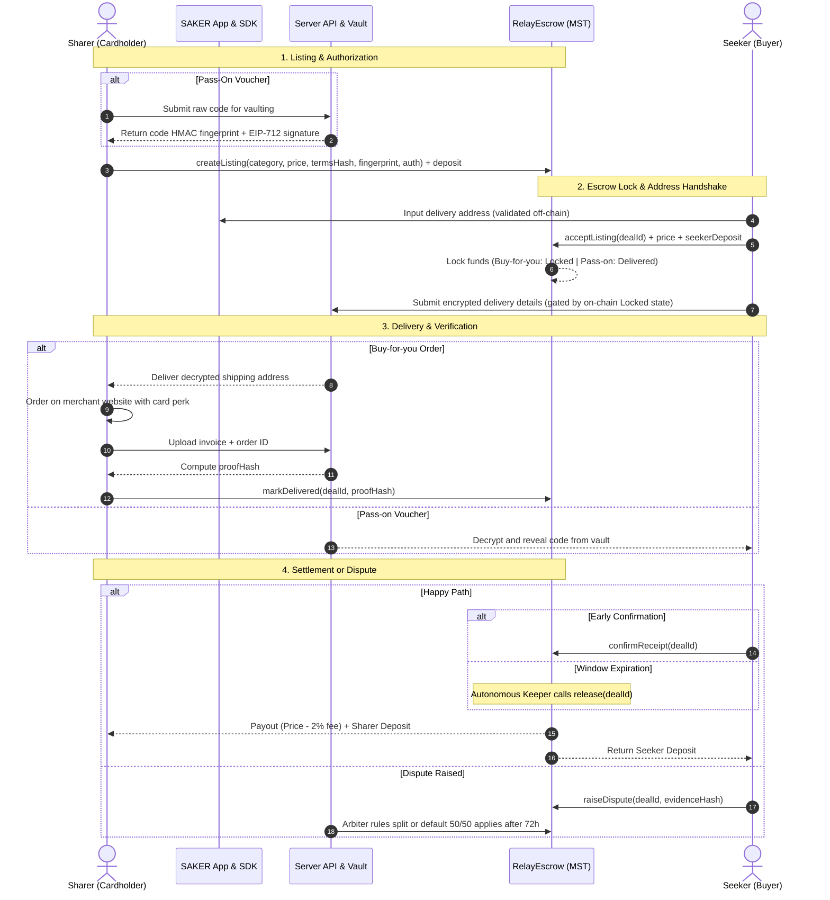
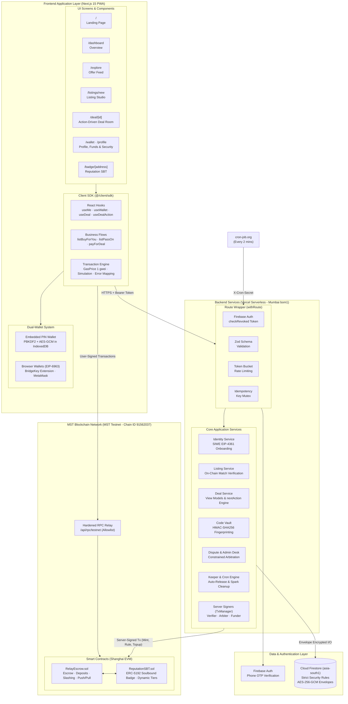

<div align="center">

# SAKER

**A trusted peer-to-peer marketplace for unused rewards and card perks, secured by smart contract escrow and on-chain reputation on MST Blockchain.**

[](https://github.com/Atharvchaskar008/SAKER/actions/workflows/ci.yml)
[](LICENSE)
[-6f42c1.svg>)](https://mstscan.com/address/0xE13c653b082E8243eD0ceE972463a949AB2743a7)
[](packages/contracts)
[](package.json)
[](docs/testing.md)
[](https://saker-app.vercel.app)
[](https://saker-app.vercel.app/api/health)

[Overview](#overview) · [How It Works](#how-it-works) · [Architecture](#system-architecture) · [Frontend Integration & SDK](#frontend-integration--client-sdk) · [Smart Contracts](#smart-contracts--economics) · [Deployments](#live-deployments--mstscan-records) · [Development](#getting-started) · [Testing](#testing--verification) · [Docs](#documentation)

</div>

---

## Overview

Every year, billions of rupees in credit card offers, airport lounge access passes, hotel discounts, wallet cashbacks, and subscription perks expire unused. The cardholders and reward owners who hold them rarely need all of them, while buyers seeking discounts have no safe, trustless mechanism to purchase them from strangers without risking scams or credential theft.

**SAKER** bridges this gap by creating a trust-minimized, peer-to-peer benefit relay:

- A **Sharer** (the cardholder or reward owner) uses their benefit on behalf of a **Seeker** (the buyer).
- The Seeker's payment sits locked in the `RelayEscrow` smart contract until the benefit is delivered and verified.
- Both sides post collateral deposits; any malicious actor is slashed to compensate the victim.
- Every successfully settled deal builds a soulbound **Trust Badge** (`ReputationSBT`, ERC-5192) on MST Blockchain, automatically raising deal limits and lowering deposit requirements.

> **Interface:** a light, minimal design system shared by the landing page (`/`) and the app
> (`/dashboard`, `/explore`, `/listings/new`, `/deals`, `/profile`): Instrument Serif, Geist and
> Geist Mono, one electric-blue accent, a generative pixel field and pixel avatars derived from each
> wallet address. Landing page designed by Atharv Chaskar.

> **MST Blockchain Buildathon #2** (Round 2 MVP). Deployed on **MST Mainnet** (Chain ID `4646`) and **MST Testnet** (Chain ID `91562037`).  
> **Production Live App:** [**saker-app.vercel.app**](https://saker-app.vercel.app) · **Mirror:** [**sakar-app.vercel.app**](https://sakar-app.vercel.app) · **System Health:** [**saker-app.vercel.app/api/health**](https://saker-app.vercel.app/api/health)

---

### Core Pillars

1. **Zero Credential Sharing**  
   Account credentials, OTPs, and credit card numbers are never exchanged. For purchases, the Sharer places the order directly on the merchant platform using their own card and delivers to the Seeker's shipping address. For vouchers, shareable promo codes are sealed in an encrypted vault and revealed only after payment is locked on-chain.
2. **Two-Sided Escrow & Slashing Protection**  
   Both parties lock collateral deposits into `RelayEscrow`. A Sharer who misses the delivery deadline is automatically slashed to refund the Seeker. Disputes undergo constrained arbitration, with a guaranteed 50/50 fallback settlement if unaddressed.
3. **Soulbound On-Chain Reputation (`ReputationSBT`)**  
   An ERC-5192 non-transferable token permanently records completed volume, unique counterparties, and fault history. Deal limits scale progressively from ₹500 to ₹10,000 as users establish provable on-chain trust.
4. **Frictionless Web2 Onboarding + Web3 Compatibility**  
   Users onboard instantly via phone OTP and an in-browser PIN-encrypted embedded wallet (PBKDF2 + AES-256-GCM in IndexedDB) with automated gas top-ups. Advanced crypto users can connect directly using **BridgeKey** (EIP-6963) or **MetaMask** and approve transactions through their own wallet.
5. **Off-Chain Privacy with On-Chain Cryptographic Proofs**  
   Personal shipping details, merchant order IDs, and vouchers are encrypted using AES-256-GCM envelope encryption. Only `keccak256` commitment hashes, EIP-712 digital signatures, and HMAC-SHA256 fingerprints touch the blockchain.
6. **Autonomous Keeper Network**  
   Smart contracts cannot self-execute. A scheduled keeper calls `release()` for expired return windows, triggers default dispute rulings, purges expired PII, and cleans up rate-limiting records every 2 minutes. Any network participant can trigger these public release methods.
7. **Native Gas Relayer Service (`/api/relay`)**  
   Users never need to hold or manage MSTC tokens for gas fees. SAKER integrates a dedicated server-side transaction relayer (`src/server/signer.ts`, `/api/relay`) that sponsors gas, manages strict nonce sequencing with exponential backoff, and provides a seamless zero-gas transaction experience.

---

## ⚡ Quick Start for Judges (2-Minute Evaluation)

Welcome, Judges! SAKER is live and accessible without mandatory wallet configuration or gas tokens.

### Option A: Instant Guest Mode (No Extension Needed)

1. Navigate directly to [**saker-app.vercel.app/explore**](https://saker-app.vercel.app/explore) or click **"Enter Guest Mode →"** on the [Login Page](https://saker-app.vercel.app/login).
2. Browse active benefit offers across E-Commerce, Dining, Travel, and Digital Vouchers.
3. Click any offer to inspect the trustless state machine, on-chain deposit requirements, and automated dispute resolution timers.

### Option B: Web3 Wallet Experience (BridgeKey or MetaMask)

1. Open [**saker-app.vercel.app/login**](https://saker-app.vercel.app/login).
2. Select **BridgeKey** or **MetaMask** — the app detects your extension and prompts to switch to **MST Chain (`4646`)**.
3. Sign the one-click EIP-4361 SIWE challenge to claim your on-chain **Trust Badge** (`ReputationSBT`).
4. In the Deal Room, test instant on-chain escrow commitments with real-time 350ms block confirmations.

### Smart Contracts on MST Mainnet (Chain ID `4646`)

- **RelayEscrow:** [`0xE13c653b082E8243eD0ceE972463a949AB2743a7`](https://mstscan.com/address/0xE13c653b082E8243eD0ceE972463a949AB2743a7)
- **ReputationSBT:** [`0x8dcF8EB4F893b415BD32c6Aab44cbecD49A4690e`](https://mstscan.com/address/0x8dcF8EB4F893b415BD32c6Aab44cbecD49A4690e)
- **RPC Endpoint:** `https://mariorpc.mstblockchain.com`

---

## How It Works

SAKER supports two distinct trade mechanisms based on whether the perk is an ordered purchase or a digital voucher code:

| Deal Type                   | Description                                                                                                                                                | Target Categories                                                                       | Release / Verification Mechanism                                                                                 |
| :-------------------------- | :--------------------------------------------------------------------------------------------------------------------------------------------------------- | :-------------------------------------------------------------------------------------- | :--------------------------------------------------------------------------------------------------------------- |
| **Buy-for-you** _(Primary)_ | The Sharer uses their card offer to order directly on the merchant site to the Seeker's name and address, submitting order confirmation and invoice proof. | E-commerce shopping, travel, flights, hotels, food delivery, movie tickets, memberships | Funds release automatically after the category return/cancellation window expires (or early if Seeker confirms). |
| **Pass-on**                 | The Sharer deposits a valid shareable promo code or digital voucher into the Code Vault before listing.                                                    | Brand gift cards, coupon codes, ride vouchers, streaming discounts                      | Code is revealed instantly upon payment. Escrow releases after a 2-hour inspection window.                       |

---

### Lifecycle Sequence



---

### Deal State Transitions

```mermaid
stateDiagram-v2
    [*] --> Listed: createListing (Sharer posts deposit)
    Listed --> Cancelled: cancelListing (Deposit refunded)
    Listed --> Locked: acceptListing [Buy-for-you] (Seeker locks payment + deposit)
    Listed --> Delivered: acceptListing [Pass-on] (Code instantly revealed)
    Locked --> Delivered: markDelivered(proofHash) (Sharer submits order proof)
    Locked --> Refunded: claimTimeout (Sharer misses deadline; deposit slashed)
    Delivered --> Completed: confirmReceipt / release() (Escrow settled & reputation earned)
    Delivered --> Disputed: raiseDispute(evidenceHash) (Seeker reports issue)
    Disputed --> Completed: Seeker withdraws dispute
    Disputed --> Resolved: resolveDispute (Arbiter split) or defaultResolve (50/50 fallback)
```



---

## System Architecture

SAKER implements a modern layered Web3 architecture where the blockchain serves as the absolute source of truth for financial commitments, state transitions, and reputation, while zero-knowledge-style off-chain envelope encryption guarantees user privacy.



---

## Frontend Integration & Client SDK

The frontend application communicates entirely through `@/client/sdk` (and `@/common`). The UI contains **no complex Web3 or blockchain logic**; instead, it is driven by a single-action view-model pattern.

### 1. Provider Setup

Wrap your application in `SakerProvider` (or `RewardRelayProvider`) to inject the client SDK context, chain configuration, and wallet session:

```tsx
import { SakerProvider } from "@/client/sdk";
import { auth } from "@/client/firebase";

export function Providers({ children }: { children: React.ReactNode }) {
  const [user, setUser] = useState(auth.currentUser);

  return (
    <SakerProvider
      config={{
        chain: {
          chainId: 91562037,
          rpcUrl: "/api/rpc/testnet",
          explorerUrl: "https://testnet.mstscan.com",
          escrow: "0x5aB34fB9CFce4a442b2CA773692a7D031D173C9A",
        },
        inrPerMstc: 100000, // Demo exchange rate: 1 tMSTC = ₹1,00,000
      }}
      getIdToken={() => auth.currentUser?.getIdToken() ?? Promise.resolve(null)}
      accountId={user?.uid ?? null} // Isolates device wallet keys per account
    >
      {children}
    </SakerProvider>
  );
}
```

---

### 2. Dual Wallet Architecture

SAKER supports two parallel wallet experiences through the `useWallet()` hook:

1. **Embedded PIN Wallet (Web2 Friendly)**
   - Keys are generated locally via WebCrypto and never transmitted in plaintext.
   - Encrypted with user's 6–12 digit PIN via PBKDF2 (>= 310,000 iterations) + AES-256-GCM.
   - Stored in IndexedDB; encrypted ciphertext backup stored in Firestore via `PUT /api/wallet/backup`.
   - Automatically locks after 30 minutes of inactivity.
2. **Injected Browser Wallets (Web3 Native)**
   - Discovered automatically via EIP-6963 (`useBrowserWallets()`).
   - Supports **BridgeKey** (`io.bridgekey.wallet`), **MetaMask**, and standard EIP-1193 providers.
   - Auto-switches chain to MST Testnet (or prompts wallet to add it) before executing transactions.

```tsx
import { useWallet, useBrowserWallets } from "@/client/sdk";

export function WalletConnectModal() {
  const { create, unlock, connectBrowserWallet, unlocked, address } = useWallet();
  const browserWallets = useBrowserWallets();

  // Option A: Unlock embedded PIN wallet
  const handlePinUnlock = async (pin: string) => {
    await unlock(pin);
  };

  // Option B: Connect BridgeKey or MetaMask
  const handleBrowserWallet = async (wallet: InjectedWallet) => {
    await connectBrowserWallet(wallet);
  };

  return (/* render UI */);
}
```

---

### 3. The "One-Button" Deal Room Pattern

The deal room is completely state-driven. `useDeal(dealId)` polls the backend every 5 seconds and returns a consolidated `DealView`. The UI simply presents **one primary button** corresponding to `deal.nextAction`, alongside minor secondary action buttons.

```tsx
import { useDeal, useDealAction, userMessage } from "@/client/sdk";

export function DealRoom({ dealId }: { dealId: string }) {
  const { data: deal, isLoading } = useDeal(dealId);
  const { mutate: runAction, isPending, error } = useDealAction(dealId);

  if (isLoading || !deal) return <LoadingSpinner />;

  return (
    <div className="deal-room">
      <h2>{deal.listing.title}</h2>
      <p>Status: {deal.statusLabel}</p>
      <p>
        Amount: {deal.priceMstc} MSTC (≈ ₹{deal.priceInr})
      </p>

      {/* Primary Action Button */}
      {deal.nextAction !== "NONE" && deal.nextAction !== "WAIT" && (
        <button
          disabled={isPending}
          onClick={() => runAction({ action: deal.nextAction, input: {} })}
        >
          {getActionLabel(deal.nextAction, deal)}
        </button>
      )}

      {/* Waiting Indicator with Context */}
      {deal.nextAction === "WAIT" && (
        <div className="status-notice">Awaiting next step: {deal.actionReason}</div>
      )}

      {error && <p className="error-text">{userMessage(error)}</p>}
    </div>
  );
}
```

#### Action Dispatcher Reference

| `nextAction` / Secondary | Eligible Role & State                    | Input Parameter                            | Internal Execution Sequence                                                                                         |
| :----------------------- | :--------------------------------------- | :----------------------------------------- | :------------------------------------------------------------------------------------------------------------------ |
| `PAY`                    | Seeker (`Listed`)                        | `{ details?: DeliveryDetails }`            | Validates delivery address → Calls `acceptListing` on-chain → POSTs encrypted address to `/api/deals/:id/details`.  |
| `MARK_DELIVERED`         | Sharer (`Locked`)                        | `{ proof: { orderId, notes?, invoice? } }` | POSTs proof & invoice to `/api/deals/:id/proof` → Computes `proofHash` → Calls `markDelivered(proofHash)` on-chain. |
| `CONFIRM`                | Seeker (`Delivered`)                     | None                                       | Calls `confirmReceipt` on-chain → Escrow executes instant payout and updates both reputation badges.                |
| `RELEASE_AVAILABLE`      | Anyone (`Delivered` past return window)  | None                                       | Calls `release(dealId)` on-chain → Releases funds and returns deposits.                                             |
| `CLAIM_REFUND`           | Seeker (`Locked` past `deliverBy`)       | None                                       | Calls `claimTimeout(dealId)` on-chain → Refunds payment and seeker deposit; slashes Sharer deposit to Seeker.       |
| `CANCEL`                 | Sharer (`Listed`)                        | None                                       | Calls `cancelListing(dealId)` on-chain → Returns Sharer deposit.                                                    |
| `RAISE_DISPUTE`          | Seeker (`Delivered` within check window) | `{ evidence: { claim, text, files? } }`    | POSTs encrypted evidence bundle to `/api/disputes/:id/evidence` → Calls `raiseDispute(evidenceHash)` on-chain.      |
| `ADD_EVIDENCE`           | Either Party (`Disputed`)                | `{ evidence: { claim, text, files? } }`    | POSTs additional evidence → Calls `addEvidence(evidenceHash)` on-chain.                                             |
| `DEFAULT_RESOLVE`        | Either Party (`Disputed` past 72h)       | None                                       | Calls `defaultResolve(dealId)` on-chain → Splits funds 50/50 without fault penalties.                               |

---

### 4. Listings Feed & Creation

```tsx
import { useListings, listBuyForYou, listPassOn } from "@/client/sdk";

// Explore Feed
export function OfferFeed() {
  const { data, fetchNextPage, hasNextPage } = useListings({ category: "ecommerce", status: "open" });
  return (/* Paginated listing cards */);
}

// Listing Creation (Buy-for-you)
const handleCreateOffer = async () => {
  const outcome = await listBuyForYou(sdkContext, {
    title: "Amazon 10% Off via HDFC Card",
    description: "Ordering any electronics up to ₹5,000",
    category: "ecommerce",
    faceValueInr: 5000,
    priceInr: 4500,
    terms: { returnPolicy: "standard", deliveryWindowHours: 48 },
  });
  console.log("Created deal ID:", outcome.dealId);
};
```

---

## Smart Contracts & Economics

The core protocol consists of two audited, verified smart contracts on MST Testnet:

### 1. `RelayEscrow.sol` (Core Escrow & Settlement)

- **State Guarding:** Strictly checks caller, status, and deadlines before every transition.
- **Policy Snapshots:** Each listing permanently snapshots fee rate, deposit rates, delivery window, and release buffer at creation; future administrative changes never alter in-flight deals.
- **Solvency Invariant:** `address(this).balance == totalEscrowed + totalWithdrawable` is asserted on every state change.
- **Push with Pull Fallback:** Native MSTC transfers use a 30,000 gas stipend; if a recipient contract reverts or rejects gas, the funds are credited to `withdrawable[recipient]` without aborting the protocol.
- **Protocol Fee:** Fixed at 2% (200 bps), charged **only on the net price paid to the Sharer**. 0% fee on refunds, cancellations, and default rulings.

### 2. `ReputationSBT.sol` (ERC-5192 Soulbound Badge)

- Non-transferable badge permanently bound to the user's wallet address (`locked(tokenId) == true`).
- Maintains an on-chain ledger of completed deals, unique counterparties, total volume, and disputes lost.
- Dynamically assigns reputation tiers that scale deal value limits and reduce collateral deposit burdens:

| Trust Tier           | Requirements                                                  | Deal Limit (Demo Rate) | Sharer Deposit | Seeker Deposit |
| :------------------- | :------------------------------------------------------------ | :--------------------- | :------------- | :------------- |
| **Tier 0: New**      | Phone-verified wallet linking                                 | ₹500 (0.005 tMSTC)     | 5% of price    | 5% of price    |
| **Tier 1: Trusted**  | 5 completed deals, 3 unique counterparties, 0 disputes lost   | ₹2,000 (0.02 tMSTC)    | 3% of price    | 5% of price    |
| **Tier 2: Verified** | 20 completed deals, 10 unique counterparties, 0 disputes lost | ₹10,000 (0.1 tMSTC)    | 2% of price    | 5% of price    |

_Note: Any lost dispute automatically demotes the user back to Tier 0._

---

## Live Deployments & MSTScan Records

### MST Mainnet (Chain ID `4646`)

- **RPC URL:** `https://mariorpc.mstblockchain.com`
- **Block Explorer:** [mstscan.com](https://mstscan.com)
- **Gas Model:** Legacy transactions, 1 gwei fixed gas price.

| Contract          | Address                                                                                                                | Source Verification / Explorer                                                            | Deployment Tx Hash                                                                                           |
| :---------------- | :--------------------------------------------------------------------------------------------------------------------- | :---------------------------------------------------------------------------------------- | :----------------------------------------------------------------------------------------------------------- |
| **ReputationSBT** | [`0x8dcF8EB4F893b415BD32c6Aab44cbecD49A4690e`](https://mstscan.com/address/0x8dcF8EB4F893b415BD32c6Aab44cbecD49A4690e) | [View on MSTScan](https://mstscan.com/address/0x8dcF8EB4F893b415BD32c6Aab44cbecD49A4690e) | [`0x0402f22b...`](https://mstscan.com/tx/0x0402f22bf88a617615947124ed84472def918cdad6d085b41d6b7b5c2fc0e121) |
| **RelayEscrow**   | [`0xE13c653b082E8243eD0ceE972463a949AB2743a7`](https://mstscan.com/address/0xE13c653b082E8243eD0ceE972463a949AB2743a7) | [View on MSTScan](https://mstscan.com/address/0xE13c653b082E8243eD0ceE972463a949AB2743a7) | [`0x575c9bf7...`](https://mstscan.com/tx/0x575c9bf7c07e1b9ca88c75f03c4a981e5fb4182c60ba5962ccaafb1c12fe5b74) |

---

### MST Testnet (Chain ID `91562037`)

- **RPC URL:** `https://testnetrpc.mstblockchain.com`
- **Block Explorer:** [testnet.mstscan.com](https://testnet.mstscan.com)
- **Gas Model:** Legacy transactions, 1 gwei fixed gas price, ~3s block time.

| Contract          | Address                                                                                                                        | Source Verification                                                                                        |
| :---------------- | :----------------------------------------------------------------------------------------------------------------------------- | :--------------------------------------------------------------------------------------------------------- |
| **ReputationSBT** | [`0x9C0a662D4eA71F9C18b0DEF392cBb1c020cAB5c6`](https://testnet.mstscan.com/address/0x9C0a662D4eA71F9C18b0DEF392cBb1c020cAB5c6) | [Verified on MSTScan](https://testnet.mstscan.com/address/0x9C0a662D4eA71F9C18b0DEF392cBb1c020cAB5c6#code) |
| **RelayEscrow**   | [`0x5aB34fB9CFce4a442b2CA773692a7D031D173C9A`](https://testnet.mstscan.com/address/0x5aB34fB9CFce4a442b2CA773692a7D031D173C9A) | [Verified on MSTScan](https://testnet.mstscan.com/address/0x5aB34fB9CFce4a442b2CA773692a7D031D173C9A#code) |

---

### On-Chain Verified Deal History

The smart contract transactions below showcase real end-to-end deal settlements and adversarial protection on MST Testnet:

| Deal ID | Flow Type   | Outcome & Settlement                                                 | Transaction Hash                                                                                                     |
| :-----: | :---------- | :------------------------------------------------------------------- | :------------------------------------------------------------------------------------------------------------------- |
| **#2**  | Buy-for-you | Completed via Seeker early confirmation; deposits returned           | [`0x84d181de...`](https://testnet.mstscan.com/tx/0x84d181def4cc8d82017a42586a7ae3e0680246d52b7ccb3efe782c4ec6f68c9d) |
| **#3**  | Pass-on     | Completed; voucher code revealed from vault                          | [`0x7bbfc203...`](https://testnet.mstscan.com/tx/0x7bbfc2039cd0dedc913bda08c87624db74d720eaa82e8b6cdbb551effe4f0db2) |
| **#4**  | Buy-for-you | Disputed & resolved for Seeker: full refund + slashed Sharer deposit | [`0x25a65efb...`](https://testnet.mstscan.com/tx/0x25a65efb3c1db7f89768ba9ad982ce6b148348047d8592e062a8f1ef3609099e) |
| **#5**  | Buy-for-you | Live site automated regression test (`check:live`)                   | [`0x0ba7836e...`](https://testnet.mstscan.com/tx/0x0ba7836e0fcde91b84a981cd2d18a4a8d1a8910796e9e63a74d028afb22d9fc1) |
| **#6**  | Pass-on     | Live site automated voucher test (`check:live`)                      | [`0xf85b446d...`](https://testnet.mstscan.com/tx/0xf85b446d13077ce65d256e42733bcee608057f457c77fd25716953ec38e66791) |
| **#7**  | Dispute     | Live site admin arbitration ruling (`check:live`)                    | [`0x4698e917...`](https://testnet.mstscan.com/tx/0x4698e917052f38c1a53f9bd589d67dc0bf5181e564ef8c7d6012d7046393322a) |

---

### Production Performance Benchmarks

Measured on the live Vercel production deployment (`bom1` Mumbai functions connecting to `asia-south1` Firestore and MST Testnet):

| Route / Interaction                        | Cold Start | Warm Execution | Round-Trip Latency    |
| :----------------------------------------- | :--------- | :------------- | :-------------------- |
| **Listings Feed (`GET /api/listings`)**    | 210 ms     | **26–58 ms**   | 76–102 ms             |
| **Deal Room (`GET /api/deals/:id`)**       | 480 ms     | **205–290 ms** | 320–380 ms            |
| **User Profile (`GET /api/me`)**           | 420 ms     | **320 ms**     | ~400 ms               |
| **Full Buy-for-you Deal (4 transactions)** | —          | —              | **~23 seconds** total |

---

## Getting Started

### Prerequisites

- **Node.js**: `v22.0.0+` (see `engines` in `package.json`)
- **npm**: `v10.0.0+`
- **Java**: `OpenJDK 21+` (Required only if running local Firebase emulators for integration tests)

### Local Installation

```bash
# 1. Clone repository
git clone https://github.com/Atharvchaskar008/__SAKER_REPO__.git
cd SAKER

# 2. Install dependencies
npm install

# 3. Compile contracts and generate TypeScript ABIs
npm run compile

# 4. Configure local environment variables
cp apps/web/.env.example apps/web/.env

# 5. Start development environment (Local Hardhat node + Next.js App)
npm run dev
```

Visit [http://localhost:3000](http://localhost:3000) to view the application.

---

### Monorepo Workspaces

```
.
├── apps/
│   └── web/                      # Next.js 15 PWA, API Routes, Client SDK, UI Components
│       ├── src/app/              # App Router pages and REST API handlers
│       ├── src/client/           # Client SDK, React hooks, wallet key management
│       ├── src/server/           # Backend services, envelope encryption, chain TxManager
│       ├── src/common/           # Isomorphic logic: category definitions, terms hashing
│       ├── scripts/              # Live check runner (live-check.ts) and demo seed script
│       └── test/                 # Unit and integration test suites
├── packages/
│   ├── contracts/                # Solidity 0.8.24 contracts, Hardhat tests, deploy scripts
│   │   ├── contracts/            # RelayEscrow.sol, ReputationSBT.sol, interfaces
│   │   ├── deployments/          # Deployment records and verified transaction receipts
│   │   └── scripts/              # Idempotent deploy, configure, verify & mainnet preflight
│   └── shared/                   # Typed ABIs, contract addresses, constants, money utils
└── docs/                         # Protocol specs, architecture, API reference, runbooks
```

---

## Testing & Verification

The codebase maintains rigorous test coverage across smart contracts, server routes, client SDK, and live deployments:

| Layer                 | Framework & Scope                                                                                                                               | Tests & Coverage                                           |
| :-------------------- | :---------------------------------------------------------------------------------------------------------------------------------------------- | :--------------------------------------------------------- |
| **Smart Contracts**   | Hardhat, Chai, Solidity-Coverage. Scenarios, reentrancy attacks, adversarial edge cases, and randomized state invariant checks.                 | **100 tests (100% statements, 100% branches, 100% lines)** |
| **Static Analysis**   | Slither 0.11 and Solhint. Automated checks for reentrancy, access control, and integer safety.                                                  | **0 High, 0 Medium vulnerabilities**                       |
| **Web Unit Tests**    | Vitest. Covers envelope crypto, SIWE signing, env validation, route helpers, deal action state machine, and PIN wallet PBKDF2/AES.              | **204 passing tests**                                      |
| **Integration Suite** | Vitest + Firebase Auth & Firestore Emulators + Local Hardhat Node. Tests complete Buy-for-you, Pass-on, and arbitration flows through the SDK.  | **61 passing tests**                                       |
| **Live Smoke Suite**  | `npm run check:live -w @rewardrelay/web`. Verifies health, security headers, rate limits, latency, and testnet transactions against production. | **8 read-only checks + live deal tests**                   |

### Common Commands

```bash
npm run test                   # Run contract tests + web unit tests
npm run contracts:coverage     # Generate Solidity code coverage report
npm run contracts:gas          # Generate gas consumption report
npm run test:integration      # Run full emulator integration suite
npm run lint                   # Check ESLint, Solhint, and Prettier formatting
npm run build                  # Typecheck and build all monorepo packages
```

---

## Security & Production Hardening

- **Envelope Encryption**: Sensitive delivery information, merchant proofs, and vouchers are encrypted using AES-256-GCM with a unique 96-bit initialization vector per record and authenticated data (AAD) bound to the document path.
- **Strict Firestore Rules**: All direct client read and write operations are blocked by security rules, except read-only access to public listings.
- **Idempotency & Concurrency**: All state-changing POST requests require an `Idempotency-Key` header with Firestore-backed distributed locks to prevent duplicate submissions or race conditions.
- **Hardened RPC Relay**: The `/api/rpc/testnet` endpoint strictly allowlists safe JSON-RPC methods (`eth_call`, `eth_sendRawTransaction`, `eth_getTransactionReceipt`, etc.) to prevent node abuse.
- **Prohibited Goods Filter**: Automatic programmatic rejection for high-risk categories (direct cashout, employee/student credentials, IRCTC railway tickets, OTP sharing, and regulated substances).

For vulnerability disclosure and security details, see [SECURITY.md](.github/SECURITY.md).

---

## Documentation

Comprehensive engineering documentation is available in the [`docs/`](docs/) directory:

- [**Architecture Guide**](docs/architecture.md): Deep dive into components, deal lifecycles, and performance engineering.
- [**Protocol Specification**](docs/protocol.md): Contract state machine, invariant proofs, gas tables, and threat model.
- [**API & Client SDK Reference**](docs/api.md): Detailed catalogue of REST endpoints, envelope schemas, and React hooks.
- [**Deployment Runbook**](docs/deployment.md): Instructions for Vercel, Firebase console, and testnet setup.
- [**Mainnet Guide**](docs/mainnet.md): Runbook for deploying to MST Mainnet (Chain ID 4646).
- [**Testing Strategy**](docs/testing.md): Guide to running local nodes, emulators, and live test runners.
- [**Demo Walkthrough**](docs/demo.md): Step-by-step demonstration guide for hackathon presentations.

---

## License

This project is licensed under the MIT License - see the [LICENSE](LICENSE) file for details.  
Copyright © 2026 Atharv Chaskar. Built on [MST Blockchain](https://mstblockchain.com).
