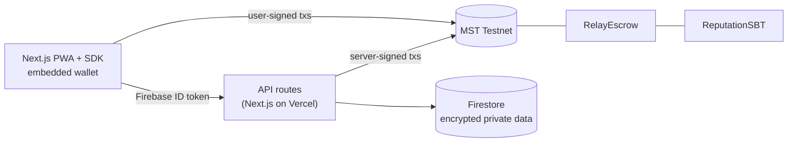

# RewardRelay

**A trusted buy-it-for-me marketplace for unused rewards, on MST Blockchain.**

[](https://github.com/Atharvchaskar008/RewardRelay/actions/workflows/ci.yml)
[](LICENSE)

Millions of rewards expire unused: card offers, wallet credits, membership prices, shareable promo
codes. RewardRelay lets the person who holds a benefit (the **Sharer**) use it for someone who wants
the discount (the **Seeker**). The Seeker's payment is held in an escrow smart contract until the
benefit is delivered, and both sides lock a deposit that a cheater loses to the other side.

> Built for MST Blockchain Buildathon #2. Runs on **MST Testnet** with test MSTC (no real money).

## How it works

| Deal type       | How the benefit reaches the Seeker                                                                                                       |
| --------------- | ---------------------------------------------------------------------------------------------------------------------------------------- |
| **Buy-for-you** | The Sharer orders in their own account with their own offer and delivers to the Seeker. No card number, login or OTP ever changes hands. |
| **Pass-on**     | A shareable code is sealed in the Code Vault and revealed only to the Seeker who paid.                                                   |

1. The Sharer lists the deal: `RelayEscrow.createListing` locks their deposit; the listing's terms are
   committed on-chain as a hash, so they cannot be switched later.
2. The Seeker pays in MSTC (price + a small deposit), held by the contract.
3. The Sharer delivers (order proof hash on-chain) or the code is revealed.
4. The Seeker confirms, or the payment is released automatically after the return window. Disputes go
   to an arbiter, with a 50/50 default ruling if nobody rules in time.
5. Both parties' soulbound **Trust Badges** (ERC-5192) record the outcome and raise their deal limits.

## Why MST Blockchain

Strangers need a neutral party to hold money and enforce deadlines. The escrow, deposits, timers,
code fingerprints, proof hashes and reputation live on MST, where anyone can verify them; personal data
stays off-chain and encrypted. Any MST app can read a user's trust level with `trustOf(address)`.

## Architecture



More: [docs/architecture.md](docs/architecture.md).

## Repository layout

```
apps/
└── web/                 Next.js app: UI, API routes, server modules, client SDK
packages/
├── contracts/           Solidity contracts, Hardhat tests, deployment scripts and records
└── shared/              ABIs, addresses, chain config and protocol rules shared by everything
docs/                    Architecture, API, protocol specification, deployment
.github/                 CI, Dependabot, issue and pull-request templates
```

## Quick start

Requirements: Node.js 22+, npm; Java 21 for the integration tests.

```bash
npm install
npm run compile                          # contracts → ABIs + TypeChain types
cp apps/web/.env.example apps/web/.env   # fill in (see docs/deployment.md)
npm run dev                              # local Hardhat node + Next.js on http://localhost:3000
```

| Command                      | Does                                                                      |
| ---------------------------- | ------------------------------------------------------------------------- |
| `npm run lint`               | Solhint, ESLint and the Prettier check                                    |
| `npm test`                   | Contract tests + web unit tests                                           |
| `npm run test:integration`   | API, SDK and end-to-end tests on the Firebase emulators and a local chain |
| `npm run contracts:coverage` | Solidity coverage                                                         |
| `npm run build`              | Type-check and build everything                                           |

## Deployed contracts (MST Testnet, chain id 91562037)

| Contract      | Address                                                                                                                        |
| ------------- | ------------------------------------------------------------------------------------------------------------------------------ |
| ReputationSBT | [`0x9C0a662D4eA71F9C18b0DEF392cBb1c020cAB5c6`](https://testnet.mstscan.com/address/0x9C0a662D4eA71F9C18b0DEF392cBb1c020cAB5c6) |
| RelayEscrow   | [`0x5aB34fB9CFce4a442b2CA773692a7D031D173C9A`](https://testnet.mstscan.com/address/0x5aB34fB9CFce4a442b2CA773692a7D031D173C9A) |

## Quality and security

- Contracts: 100 tests including adversarial/reentrancy and a randomized solvency invariant; 100% line
  and branch coverage; Slither with no high or medium findings.
- App: 164 unit tests and 53 integration tests (Firebase Auth/Firestore emulators + a local Hardhat
  node), including end-to-end runs of both deal types through the SDK.
- Every private-data path re-reads the deal on-chain; personal data and codes are envelope-encrypted
  (AES-256-GCM); one phone number ↔ one wallet; strict CSP and security headers.
- Threat model, review results and known MVP limitations: [SECURITY.md](SECURITY.md).

## Documentation

|                                      |                                                               |
| ------------------------------------ | ------------------------------------------------------------- |
| [Architecture](docs/architecture.md) | Components, lifecycle, flows, data model                      |
| [Protocol](docs/protocol.md)         | Contract state machine, money flows, invariants, threat model |
| [API and SDK](docs/api.md)           | Routes, errors, the deal view and UI action mapping           |
| [Deployment](docs/deployment.md)     | Local setup, contracts, Firebase, Vercel, cron                |
| [Contributing](CONTRIBUTING.md)      | Workflow and conventions                                      |

## License

[MIT](LICENSE) © 2026 Atharv Chaskar
