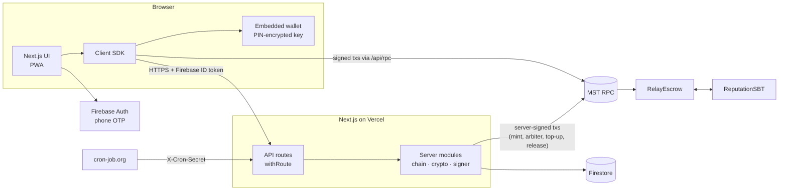
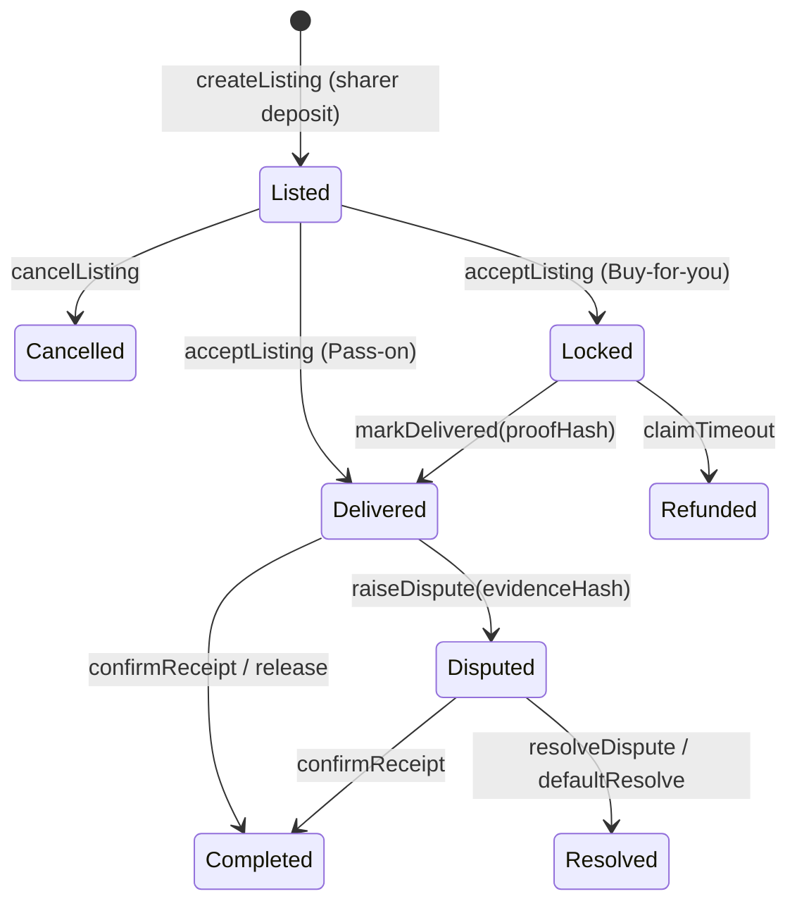

# Architecture

SAKER is a trusted buy-it-for-me marketplace on MST Blockchain. A **Sharer** holds a benefit
(card offer, wallet credit, membership price, shareable code); a **Seeker** wants the discount and pays
in MSTC, held by an escrow smart contract until delivery.

## System overview



| Component                              | Responsibility                                                                                           |
| -------------------------------------- | -------------------------------------------------------------------------------------------------------- |
| `RelayEscrow`                          | Deals, deposits, deadlines, disputes, payouts; per-deal policy snapshot; EIP-712 Pass-on authorisation   |
| `ReputationSBT`                        | Soulbound Trust Badge (ERC-5192): tiers, deal limits, completed deals, Relay Points                      |
| API (`apps/web/src/app/api`)           | Identity and wallet linking, listing verification, private deal data, Code Vault, disputes, cron, health |
| Server modules (`apps/web/src/server`) | Env validation, chain readers, transaction manager, envelope encryption, Firestore repositories          |
| Client SDK (`apps/web/src/client/sdk`) | Typed API client, transaction helpers, flows, React hooks                                                |
| `packages/shared`                      | ABIs, addresses, chain config, enums, money/listing rules, `computeNextAction`                           |
| Firestore                              | Listing metadata (public), server-only indexes, encrypted private data                                   |

## Principles

1. **The chain is the source of truth** for money and deal status; every privileged server action
   re-reads the deal on-chain first.
2. **Only what strangers must trust goes on-chain**: escrow, deposits, deadlines, code fingerprints,
   proof and evidence hashes, reputation.
3. **Private data stays off-chain**, envelope-encrypted, and is served only to the deal's parties.
4. **The UI needs no blockchain logic**: the deal view carries `nextAction`, labels, amounts in MSTC
   and ₹, deadlines and explorer links.

## Deal lifecycle



The full state machine, money flows, invariants and threat model are in
[protocol.md](protocol.md).

## Main flows

**Buy-for-you**: the Sharer lists (createListing + chain-verified metadata) → the Seeker pays
(acceptListing) and sends delivery details (encrypted) → the Sharer orders in their own account,
submits the order id (encrypted) and calls `markDelivered(proofHash)` → the Seeker confirms, or anyone
releases after the return window (the cron does it every 2 minutes).

**Pass-on**: the Sharer's code is fingerprinted (HMAC) and sealed in the Code Vault; the server signs
an EIP-712 authorisation used by `createListing` → the Seeker pays and the deal is delivered at once →
the code is revealed only to that Seeker → confirm, or dispute within the check window.

**Disputes**: each party submits an evidence bundle (encrypted) and commits its hash on-chain → the
admin desk shows the evidence, the order proof and a rulebook suggestion → the arbiter signer calls
`resolveDispute`; without a ruling, either party can apply the 50/50 default after the timeout.

## Data model (Firestore)

| Collection                                                          | Contents                                                         | Access      |
| ------------------------------------------------------------------- | ---------------------------------------------------------------- | ----------- |
| `listings/{dealId}`                                                 | Public listing metadata (hash-checked against the chain)         | public read |
| `users/{uid}`, `phoneIndex`, `walletIndex`                          | One phone ↔ one wallet, onboarding state                         | server only |
| `deals/{dealId}` (+ `private/`, `files/`, `access/`)                | Deal index, encrypted details/proof, encrypted files, access log | server only |
| `vault/{fingerprint}`                                               | Encrypted Pass-on codes                                          | server only |
| `disputes/{dealId}`, `audit/`                                       | Encrypted evidence bundles, append-only arbiter audit            | server only |
| `challenges`, `idempotency`, `rateLimits`, `locks`, `walletBackups` | Infrastructure                                                   | server only |

Firestore rules deny every client write and every read except `listings`.

## Reliability and performance

**Every backend call is bounded.** Firestore and Firebase Auth calls have an 8 s deadline, an MST RPC
read 9 s (retries included), the deal timeline 5 s and the secondary parts of a deal view 3 s. A
timeout names the operation in the logs and reaches the user as "SAKER is temporarily
unavailable", never as a hang. Sending a signed transaction is the one call that is not cut short.

| When this fails or hangs         | What users see                                                                                                               |
| -------------------------------- | ---------------------------------------------------------------------------------------------------------------------------- |
| MST RPC                          | deal pages answer "temporarily unavailable" within about 10 s; `/api/health` reports `down`                                  |
| Event scan (timeline)            | the deal view without its timeline                                                                                           |
| Firestore, for a listing's text  | the deal view from the chain, without the listing text                                                                       |
| Firestore, for writes            | the action fails fast and can be retried with the same Idempotency-Key                                                       |
| A server wallet runs dry         | the action is refused with a clear message; `/api/health` turns `degraded`; a missed welcome top-up is retried by the keeper |
| A serverless response ends early | release-on-visit and index sync run in `after()`, so they finish; the keeper (every 2 minutes) is the guarantee              |

**Reads are shared and cached where it is safe.** Concurrent requests share one in-flight read (the
latest block, a deal's events, a public deal view's deal and listing); immutable data is kept (block
timestamps, past deal events, rescanned only from the last scanned block); a few values are reused
for seconds (the latest block 1.5 s, other users' badges 5 s, the pause flag 10 s). A user's own
badge, private-data checks and every privileged action read the chain fresh.

**Independent work runs side by side**: the deal view starts the chain clock, the listing and the
timeline before the deal and the caller's wallet are known; the health checks run in parallel; wallet
set-up mints the badge and sends the top-up at the same time. Reads without private data use lighter
session and rate-limit checks (see [SECURITY.md](../.github/SECURITY.md) §5); writes keep the strict ones.

**Measured** (production build against Firebase and MST Testnet, median of warm requests): a deal page
in about 0.3 s (was 1.5 s), `/api/me` 0.3 s, the listings feed 0.05 s; 150 simultaneous requests are
all served without an error. Every response carries a `Server-Timing` header with the breakdown.

## Repository layout

```
apps/web            Next.js app (UI + API routes + server modules + SDK)
packages/contracts  Solidity contracts, Hardhat tests, deployment scripts and records
packages/shared     ABIs, addresses, chain config, protocol rules shared by everything
docs/               This documentation
```
